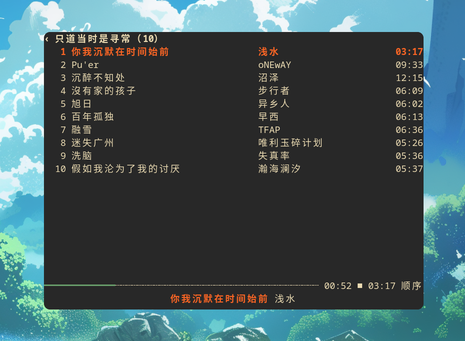

# musicyi

[](https://github.com/yifedora/musicyi/actions/workflows/ci.yml)
[](https://github.com/yifedora/musicyi/releases)
[](LICENSE)

终端里的多来源音乐播放器。启动后是一个**单一首页列表**，按顺序汇总网易原创、
街声推荐、雀乐推荐、本地列表与最近播放；选中后进入该栏目的内容列表，`Esc` 逐级
返回首页，并停在上次选中的位置。


| 歌词纯享 | 雀乐推荐列表 |
| --- | --- |
|  |  |

- 界面：ratatui 0.30 / crossterm
- 网络：tokio + reqwest（rustls）
- 音频：rodio 0.23 + symphonia，先缓存再解码，seek 准确
- 标签：lofty 读写本地文件标签、内嵌歌词与封面
- 存储：M3U 歌单 + JSONL 历史 + TOML 配置，无数据库
- 桌面集成：MPRIS（媒体键、playerctl、桌面媒体控件）
- 后端：本机 `netease-cloud-music-api-alger`（Node），默认 `http://127.0.0.1:3000`

## 功能

- **单一首页**：首页列出 5 个入口，只显示编号与栏目名：
  1. 网易原创（前 30 首）
  2. 街声推荐（前 30 首）
  3. 雀乐推荐（打开后列出最新 10 期）
  4. 本地列表
  5. 最近播放（保留 `x` / `Delete` 删除历史）
  每个列表都会记住自己的指针位置，进入歌单再返回不会跳回第一项。
- **网易云**：只使用官方直链与官方 30 秒试听，不经过任何解灰音源；无法播放时
  自动跳过。保留单曲搜索、网易云歌单搜索与链接 / ID / M3U 打开。
- **街声**：推荐取前 30 首；播放时由本机 API 把 HLS 转封装为 MP3。
  详情接口同时返回纯文本或 LRC 歌词。
- **雀乐**：一次抓取最新 10 期，歌单与歌曲同时返回，直接播放 `cdn2.indie.cn`
  的 MP3；歌单提供的纯文本歌词也能显示。
- **本地音乐**：递归扫描 `~/Music/playlist`（可配置），文件名
  `歌手 - 标题.mp3` 作为主要线索。
- **本地转换与标签**：`t` / `T` 用网易云搜索匹配标题、歌手、专辑，并把歌词与
  封面一起写入**转换目录**里的副本（默认 `~/Music/musicyi/local/`）。原始文件
  始终不动，列表优先播放已转换的副本。
- **歌词与封面**：默认打开，`l` 显示 / 隐藏；左边封面用单色 braille 点阵渲染成
  无边框的抽象小图，高度随歌词面板动态缩放。LRC 自动滚动，`PageUp` / `PageDown`
  或 `[` / `]` 手动滚动；雀乐 / 街声的纯文本歌词按宽度换行，同样支持滚动。
- **播放**：播放 / 暂停、上一首 / 下一首、进度与 seek、音量、列表循环 / 单曲 /
  随机 / 顺序；播放条分两行无边框且贴住终端底部：上行是整宽细线进度条，右端显示 `已播放 ● 总时长 短模式名`（`●` 播放 / `■` 暂停 / `…` 加载，默认样式）；
  下行居中显示 `歌名 歌手`，与底部提示合并在同一行（提示左侧停靠，无提示时歌曲居中）。连续失败会自动跳过并在达到保护上限后停止。
- **跟随当前**：自动切歌时列表指针移到正在播放的歌曲；手动用 `j` / `k` / `g` /
  `G` 移动列表后暂停跟随，`F` 可重新打开。
- **界面适配**：最小支持 60×20；更小时只显示一行提示。首页为 2 行块字字标 +
  单列居中菜单；歌词左侧为无边框封面、非当前歌词行压暗。
  歌曲表按宽度动态决定是否显示专辑列（约 96 列起），
  所有单元格先截断再加省略号；街声列表固定只显示 `# / 标题 / 歌手 / 时长`。
  整体视觉参考 [go-musicfox](https://github.com/go-musicfox/go-musicfox) 重设计。
- **错误不打断列表**：已有数据时加载失败只在标题和底部状态行提示，列表继续可用；
  空列表才显示整屏错误，并提示 `R` 重试。
- **搜索框默认隐藏**：按 `/` 才调出单行搜索框，只占 1 行，`Esc` 收起。
- **下载**：只下载当前歌曲，无队列、无并发，不写标签。
- **桌面集成**：MPRIS 媒体键与 `playerctl` 控制。
- **会话恢复**：退出时保存队列、当前索引与进度，下次启动暂停在原位置。

已移除：解灰音源（酷狗 / 酷我 / 咪咕 / GD音乐台）、自定义音源、封面 Tab 页、
YRC 逐字歌词、罗马音、手动歌词偏移、设置页等。

## 环境要求

- Linux（PipeWire 或 PulseAudio）
- Rust 1.88+
- Node.js 18+（运行本机网易云 API）
- `ffmpeg`（街声 HLS 转 MP3，需在 `PATH` 中）
- 编译依赖：
  - Fedora：`sudo dnf install alsa-lib-devel pkg-config`
  - Debian / Ubuntu：`sudo apt install libasound2-dev pkg-config`
- MPRIS（仅 Linux）需要可用的 D-Bus session（常规桌面环境默认满足）

## 安装与运行

```bash
cd ~/.local/share/musicyi

# 构建并安装到 ~/.local/bin
./install.sh

# 或者只构建，直接运行
cargo build --release
./target/release/musicyi
```

首次使用前装 API 依赖（`package-lock.json` 已锁定版本），再启动本机 API（已在运行会直接返回）：

```bash
cd api-server && npm ci && cd ..
./api-server/start.sh
```

停止 API：`./api-server/stop.sh`

API 默认只监听 `127.0.0.1:3000`，不会暴露到局域网。确需给其他设备使用时，
显式设置 `HOST=0.0.0.0` 再启动：

```bash
HOST=0.0.0.0 ./api-server/start.sh
```

后端仅在需要时手动启动，不提供 systemd 用户服务。

`api-server/` 的依赖通过 `package.json` 与 `package-lock.json` 锁定（`node_modules` 不入库）。换机器 / 重新 clone 后：

```bash
cd ~/.local/share/musicyi/api-server
npm ci
./start.sh
```

> 国内网络构建慢时，可自行在 `~/.cargo/config.toml` 配置源替换镜像（如 rsproxy）；分发包不内置任何镜像配置。

## 用法

启动后可以直接带一个参数：

```bash
musicyi                                  # 打开首页
musicyi "周杰伦"                          # 搜索单曲
musicyi "https://music.163.com/#/song?id=1858110236"
musicyi "https://music.163.com/#/playlist?id=3778678"
musicyi ~/Music/list.m3u                 # 打开 M3U
musicyi ~/Music/song.flac                # 播放本地文件
```

首页 5 个入口：

- **网易原创**：`Enter` 进入前 30 首；再 `Enter` 播放选中歌曲，`Esc` 回首页。
- **街声推荐**：前 30 首；选中 `Enter` 播放时由本机 API 转好 MP3 再缓存。
  列表里的时长与专辑会在首次播放该曲时补全。
- **雀乐推荐**：列出最新 10 期；`Enter` 打开一期，再 `Enter` 播放歌曲，
  `Esc` 返回期数列表。
- **本地列表**：扫描 `~/Music/playlist`（可用 `[local].dir` 修改）；
  `t` 转换选中歌曲，`T` 批量转换尚未生成副本的歌曲。
- **最近播放**：最多 50 首去重后的播放记录，`x` / `Delete` 删除选中记录。

搜索框默认隐藏：

- `/` 调出单曲搜索框，输入关键词后 `Enter` 搜索；`Esc` 收起输入框。
- `f` 调出网易云歌单搜索框。
- `o` 调出“打开”框，可输入路径、链接、ID 或 M3U。
- 纯数字 ID 先按歌曲查询，查不到再按歌单查询。
- 输入框里 `Enter` 确认，`Esc` 放弃输入。

### M3U

M3U 中每一项可以是本地路径，也可以是网易云歌曲链接 / ID：

```m3u
#EXTM3U
#EXTINF:234,Artist - Title
./music/01.flac
https://music.163.com/#/song?id=1858110236
10086
```

- 相对路径按 M3U 文件所在目录解析。
- `#EXTINF` 的标题和时长会作为回退信息；本地文件优先用文件名
  `歌手 - 标题`，标签用于专辑 / 时长兜底。
- 不存在或无法解码的文件会在播放时自动跳过，不会中断整个歌单。

## 快捷键

| 按键 | 作用 |
| --- | --- |
| `j` / `k`、`↓` / `↑` | 上下移动 |
| `g` / `G` | 跳到列表首 / 尾 |
| `Enter` | 打开栏目 / 播放选中歌曲 / 打开歌单 / 确认输入 |
| `Esc` | 收起输入 / 返回上一级 / 回到首页 |
| `/` | 调出单曲搜索框 |
| `f` | 调出网易云歌单搜索框 |
| `o` | 打开路径 / 链接 / ID / M3U |
| `Space` | 播放 / 暂停 |
| `n` / `p` | 下一首 / 上一首 |
| `←` / `→` | 快退 / 快进 5 秒 |
| `+` / `-` | 音量加 / 减 |
| `r` | 切换播放模式（列表循环 / 单曲 / 随机 / 顺序） |
| `l` | 显示 / 隐藏歌词与封面（默认打开） |
| `v` | 歌词纯享：歌词铺满内容区（列表隐藏） |
| `PageUp` / `PageDown`、`[` / `]` | 向上 / 向下滚动歌词 |
| `F` | 开 / 关“跟随当前歌曲” |
| `t` / `T` | 转换并补全选中 / 未转换的本地歌曲 |
| `x` / `Delete` | 从最近播放删除选中记录 |
| `d` | 下载当前歌曲 |
| `R` | 刷新当前栏目 |
| `?` | 打开 / 关闭帮助 |
| `q` | 退出 |
| `Ctrl+C` | 强制退出 |

输入状态下可正常输入文本（包括空格）；`Enter` 确认，`Esc` 收起输入框。

## 配置

默认路径（遵循 XDG）：

- 配置：`~/.config/musicyi/config.toml`
- 数据：`~/.local/share/musicyi/`
  - 历史：`history.jsonl`
  - 会话：`session.json`
  - 歌单目录：`playlists/`（保留给 M3U 文件，程序不会自动扫描）
- 本地音乐默认目录：`~/Music/playlist/`
- 本地转换默认目录：`~/Music/musicyi/local/`
- 音频缓存：`~/.cache/musicyi/audio/`
- 日志：`~/.local/state/musicyi/logs/`

配置文件首次启动自动生成，常用项：

```toml
[api]
base_url = "http://127.0.0.1:3000"
timeout_secs = 15
real_ip = ""                      # 需要时可填，绕开部分网络风控

[player]
quality = "exhigh"                # standard / higher / exhigh / lossless / hires
volume = 0.8
mode = "list_loop"                # list_loop / single / shuffle / sequential
cache_limit_mb = 2048

[ui]
restore_session = true            # 退出时保存队列 / 索引 / 进度
mpris = true                      # 启用 MPRIS 桌面控制

[download]
dir = ""                          # 留空使用 ~/Music/musicyi

[local]
dir = ""                          # 留空使用 ~/Music/playlist
output_dir = ""                   # 留空使用 ~/Music/musicyi/local
tag_delay_ms = 220                # 批量转换时每个请求的间隔，避免风控
```

旧配置里的 `[source]` 表（`unblock`、`unblock_order`、`proxy`、`custom`）会被
自动忽略，保存配置时消失。

设置 `MUSICYI_ROOT` 环境变量可把所有可写路径收拢到指定目录，便于便携使用。

命令行参数：

```bash
musicyi [URL|ID|M3U|关键词]
musicyi --api-base http://127.0.0.1:3000
musicyi --quality lossless
musicyi --clear-cache
musicyi --paths
```

`--paths` 打印配置、数据、历史、会话、歌单、缓存与日志路径。

> 旧版 SQLite 已不再读写，可直接删除：
> `rm -f ~/.local/share/musicyi/musicyi.db*`。历史会从新的 JSONL 文件重新积累。

## 下载

- 按 `d` 下载当前播放歌曲。
- 文件名格式：`{artist} - {title}.{ext}`，只替换非法字符。
- 同名文件不覆盖，自动追加 ` (1)`、` (2)`。
- 默认目录 `~/Music/musicyi`，可用 `[download].dir` 修改。
- 不写标签、不嵌封面 / 歌词，一次只下载一首。
- VIP / 版权受限歌曲可能只返回 30 秒试听片段，或官方音源不可用。

## 本地音乐、转换与标签

本地列表扫描 `[local].dir`（默认 `~/Music/playlist/`），只收集 rodio /
symphonia 支持的音频扩展名；目录会递归读取，隐藏文件跳过。原始文件只读，
不会被修改。

转换流程：

- `t`：对选中歌曲用「标题 + 歌手」搜索网易云，按标题、歌手与时长综合匹配；
  匹配到后复制原文件到 `[local].output_dir`（默认 `~/Music/musicyi/local/`），
  写入 title / artist / album、歌词（USLT）与封面（Front Cover），再原子改名。
- `T`：批量处理尚未生成转换副本的歌曲；底部状态行显示当前进度，每首歌之间
  默认等待 220 ms（`[local].tag_delay_ms`），连续失败会自动中止。
- 转换副本按原目录结构保存，扩展名不变；原文件不动。列表会优先播放副本。
- 输出目录与源目录相同时会拒绝转换，避免覆盖原文件。
- 找不到匹配、网络失败或文件不可写时会跳过，不会写入猜测结果。

## MPRIS 与媒体键

默认启用（`[ui].mpris = true`）：

```bash
playerctl -l                    # 应出现 musicyi
playerctl -p musicyi status
playerctl -p musicyi metadata
playerctl -p musicyi play-pause
playerctl -p musicyi next
playerctl -p musicyi position 30
```

D-Bus 名称为 `org.mpris.MediaPlayer2.musicyi`。没有 D-Bus session 时 MPRIS
启动失败并提示，不影响 TUI 本身。

## 会话恢复

开启 `restore_session` 后，退出时把队列、当前索引与进度写入 `session.json`；
下次启动恢复到该位置并保持暂停，按空格继续。关闭后不读也不写会话文件。

## 音源策略

1. **网易官方直链**：`/song/url/v1`，按当前音质请求；拿不到 URL 时自动逐档降到
   `standard`，避免无损不可用导致整首失败。
2. **官方试听**：只有官方返回 30 秒试听时才播放试听，不再尝试任何第三方音源。
3. **无法播放**：自动跳到下一首；连续失败达到队列长度（最多 8 首）后停止，
   避免整个队列不可播时无限循环。

不再有 `[source]` 配置、解灰音源与自定义 HTTP 接口。

### 雀乐与街声

- 雀乐：本机 API 抓取 `indie.cn` 首页最新 10 个 `vol`，汇总每期歌单与歌曲；
  播放地址、封面、歌词都直接使用 `cdn2.indie.cn` 的链接。歌词 URL 返回无时间轴
  纯文本时会自动按纯文本显示。
- 街声：抓取推荐前 30 首（推荐页每页 20 首，自动翻页去重），单曲详情补时长、
  专辑、封面与歌词；播放时由本机 API 把 HLS 无损转封装为 MP3 缓存。歌词为纯文本时
  同样按纯文本显示。

> 本机 API 的路由表与实现细节见 [DEVELOPMENT.md](DEVELOPMENT.md#api-server)。

## 常见问题

**启动后显示“API 未连接”**

```bash
cd ~/.local/share/musicyi
./api-server/start.sh
tail -n 50 api-server/server.log
curl http://127.0.0.1:3000/search/hot/detail
```

Node 服务首次启动需要联网获取匿名 token，稍等几秒即可。

**某首歌播放失败**

VIP / 下架 / 版权限制的歌曲可能没有官方直链，或只提供 30 秒试听。程序会自动跳过
无法播放的歌曲；看日志：

```bash
tail -f ~/.local/state/musicyi/logs/musicyi.log.$(date +%Y-%m-%d)
```

**接口返回 `-460` 风控错误**

接口返回 `{"code":-460,"message":"检测到您的网络环境存在风险"}` 表示网易拒绝了
当前出口 IP。在 `config.toml` 里填入一个可用 IP：

```toml
[api]
real_ip = "114.114.114.114"
```

该参数只随 `song/url/v1`（取播放链接）发送，不会影响搜索等接口。

**本地文件打不开**

确认路径存在、扩展名在 rodio/symphonia 支持范围内（mp3 / flac / m4a / aac /
ogg / opus / wav / aiff / alac 等）。默认扫描目录是 `~/Music/playlist`，
可用 `[local].dir` 修改。

**本地转换没有生成副本**

先确认 API 可用；转换依赖网易云搜索，找不到匹配时会跳过。检查
`[local].output_dir` 是否与 `[local].dir` 相同（相同会被拒绝），以及目标目录是否
可写。进度与结果会在底部状态行显示。

**街声歌曲无法播放或一直显示缓存中**

确认 `ffmpeg` 在 `PATH` 中，并检查 API 日志：

```bash
which ffmpeg
curl -I http://127.0.0.1:3000/musicyi/catalog/streetvoice/realtime
tail -n 50 ~/.local/share/musicyi/api-server/server.log
```

**MPRIS 没有出现**

确认运行在图形会话中且 `DBUS_SESSION_BUS_ADDRESS` 可用，配置中
`[ui].mpris = true`；然后重启程序并执行 `playerctl -l`。

**歌词为空**

远程歌曲可能没有歌词；翻译取决于接口是否返回。本地歌曲读取转换副本里的内嵌
歌词（USLT）；雀乐 / 街声的纯文本歌词会按歌词列宽度换行，可用
`PageUp` / `PageDown` 或 `[` / `]` 手动滚动。

**右侧框线离终端边缘比左侧远**

这不是界面留白，而是终端按整数列排布：窗口宽度不是字符宽度的整数倍时，
foot 在非最大化 / 非全屏窗口里默认把多出来的像素全部放在右侧。给
`~/.config/foot/foot.ini` 的 `[main]` 加一行 `pad=0x0 center`，网格会在窗口内
居中，左右留白即可对称（其他终端可查对应的“网格居中”选项）。

**想重新开始**

```bash
rm -rf ~/.cache/musicyi/audio \
       ~/.local/share/musicyi/history.jsonl \
       ~/.local/share/musicyi/session.json
```

下载与转换后的音乐文件不会被删除。

## 版权说明

- 本软件是播放器，不拥有、不存储、不分发任何音乐作品。所有歌曲、封面、歌词、
  专辑信息的版权归原权利人（词曲作者、音乐人及各音源平台，如网易云音乐、
  街声、雀乐等）所有。
- **仅限互联网试听**：通过音源平台获取的音频仅用于个人试听。部分歌曲（如网易云）
  只能拿到官方 30 秒试听片段，即为正常现象。
- **24 小时内删除**：试听产生的缓存文件（`~/.cache/musicyi/audio/`）及通过 `d`
  下载到本地的文件，均须在 **24 小时内删除**；禁止以任何形式传播、上传、
  出售或用于商业用途。
- 如需完整收听，请通过正版渠道购买或订阅（网易云音乐 VIP、雀乐 / 街声会员等）。
- 本项目与各音源平台无任何隶属或背书关系；因使用本软件产生的版权纠纷由使用者自行承担。
- 若权利人认为本项目侵犯其权益，请通过 GitHub Issues 联系，我们会及时处理。

## 许可

版权所有 © 2026 yifedora。本软件以 GPL-3.0-or-later 发布，见 [LICENSE](LICENSE)。

接口能力来自开源项目 [netease-cloud-music-api-alger](https://github.com/algerkong/netease-cloud-music-api)，
交互灵感来自 [go-musicfox](https://github.com/go-musicfox/go-musicfox) 与
[AlgerMusicPlayer](https://github.com/algerkong/AlgerMusicPlayer)。

开发者文档（架构 / 目录结构 / api-server / CI / 发布流程）见 [DEVELOPMENT.md](DEVELOPMENT.md)。
